# LEDSmokeAnalysis (LEDSA)

LEDSA (LEDSmokeAnalysis) is a Python-based software package for the computation of spatially and temporally resolved light extinction coefficients from photometric measurements. The method relies on capturing the change in intensity of individual light sources due to fire-induced smoke. Images can be acquired within laboratory experiments using commercially available digital cameras.

[](https://pypi.org/project/ledsa/)
[](https://github.com/FireDynamics/LEDSmokeAnalysis/actions/workflows/build_documentation.yaml)
[](https://github.com/FireDynamics/LEDSmokeAnalysis/actions/workflows/python-publish.yml)

## Installation

### Requirements

- Python 3.9 to 3.12
- pip (Python package installer)

### Installation from PyPI

The easiest way to install LEDSA is via pip:

```bash
python -m pip install ledsa
```

### Installation from Source

To install LEDSA from source:

1. Clone the repository:
   ```bash
   git clone https://github.com/FireDynamics/LEDSmokeAnalysis.git
   cd LEDSmokeAnalysis
   ```

2. Install the package:
   ```bash
   pip install .
   ```

## Usage

LEDSA can be used via its command-line interface (CLI). The general structure is:

```bash
python -m ledsa [ARGUMENT] [OPTIONS]
```

### Configuration

Create a default configuration file:
```bash
python -m ledsa -conf
```

Create an analysis configuration file:
```bash
python -m ledsa -conf_a
```

### Main Workflow

The typical workflow:

1. **Step 1: Find LEDs on a reference image**
   ```bash
   python -m ledsa -s1
   ```

2. **Step 2: Assign LEDs to LED arrays**
   ```bash
   python -m ledsa -s2
   ```

3. **Step 3: Analyze light intensity changes among different images for the RGB color channels**

   ```bash
   python -m ledsa -s3_fast -rgb
   ```

4. **Calculate 3D coordinates of the individual LEDs**
   ```bash
   python -m ledsa -coord
   ```

5. **Run computation of extinction coefficient**
   ```bash
   python -m ledsa --analysis
   ```

For a complete list of options, run:
```bash
python -m ledsa --help
```

### Stacked multi-camera analysis

Several cameras that watch the same LED arrays can be inverted jointly:

```bash
python -m ledsa -conf_s   # writes config_stacked.ini
python -m ledsa -as
```

`config_stacked.ini` holds the solver and domain settings in `[DEFAULT]`, one `[simulation_N]`
section per camera and a `[led_arrays]` section mapping virtual array IDs to the array IDs of the
individual runs. Since image IDs are counted per run, `num_ref_images` and `ref_img_indices` can
be set per `[simulation_N]` section; pick the reference images of all cameras from the same time
window before the fire.

### Temperature correction (optional)

LEDs lose radiant power as they heat up, which would otherwise be read as extinction. Reduction
factors determined outside LEDSA are given per camera channel in `config_analysis.ini` (and
likewise in `config_stacked.ini`):

```ini
[temperature_correction]
   reduction_file_channel_0 = reduction_factors_red.csv
   reduction_file_channel_1 = None
   reduction_file_channel_2 = None
```

The file is either a table with the time in seconds in the first column and the heights in metres
as column headers, or a list with the columns `height`, `time` and `reduction_factor`:

```
Time / s,3.3,3.2,3.1,2.9,2.6
0,1.0,1.0,1.0,1.0,1.0
60,0.991,0.993,0.994,0.996,0.998
```

The time counts from `start_time` of `config.ini`, like `Experiment_Time[s]` in
`analysis/image_infos_analysis.csv`. The intensities are divided by the bilinearly interpolated
factors before I0 is computed; images and LEDs outside the table stay uncorrected, with a
warning. The header of each result file states the correction applied.

### Pedestal from the far field of the LED strips (optional)

The sum over a search area also holds light that does not dim with the LED: the residual dark
level of the sensor, ambient light and light that smoke scatters into the line of sight. In dense
smoke this pedestal saturates the extinction coefficients. With

```ini
[analyse_photo]
farfield_distances = 150 300
```

in `config.ini`, step 3 takes the pedestal from two bands beside each LED, 150 to 300 px across the
strip and at least 150 px from any LED, using the lower of the two sides after smoothing both
along the strip. It writes the sum minus the pedestal as `farbg_sum_col_val` and the pedestal as
`farbg_pedestal`; `reference_property = farbg_sum_col_val` analyses the corrected sum.



The bands have to lie beyond the light of the LEDs and their halo, which holds if
`farbg_pedestal / sum_col_val` stays below about 1 % in the reference images. The correction has
been tested in dark rooms only: ambient light that is brighter beside the strip than behind the
LEDs makes it subtract too much.

## Demo

LEDSA includes a demo that demonstrates its functionality using sample data.

### Setting Up the Demo

The demo setup will download approximately 5GB of data from the internet:

```bash
python -m ledsa --demo --setup /path/to/demo/directory
```

This will create two directories:
- `image_data`: Contains the sample images
- `simulation`: Contains configuration files and results

### Running the Demo

After setting up the demo, you can run it:

```bash
python -m ledsa --demo --run
```

By default, the demo uses 1 core. You can specify more cores:

```bash
python -m ledsa --demo --run --n_cores 4
```

## Documentation

Comprehensive documentation is available at [https://firedynamics.github.io/LEDSmokeAnalysis/](https://firedynamics.github.io/LEDSmokeAnalysis/)

## Contributing

Changes are made via pull requests into master; drafts can be used for discussion. Every merge into master is followed by a new version tag following semantic versioning.

## License

LEDSA is licensed under the MIT License. See the LICENSE file for details.

## Authors

- Kristian Börger (boerger@uni-wuppertal.de)
- Lukas Arnold (arnold@uni-wuppertal.de)
